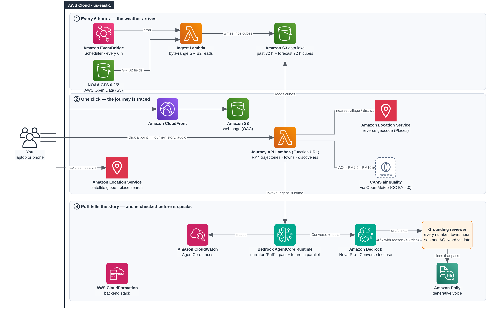

# Biography of a Breath

**Click anywhere on Earth, and the air above that spot tells you where it has been and who breathes it next.**

Live: https://d28nym7zkli7me.cloudfront.net/ · Demo video: _link to add_

Built for the AWS Builder Center **Weekend Challenge: Map it**.

A wind spirit called Puff becomes the air over the point you click and flies its whole life: 72 hours back through real NOAA wind to where that air came from, a pause over your head right now, and 72 hours forward through the forecast to the towns that breathe it next. Puff narrates the journey out loud — and nothing it says reaches you unless the data behind it agrees.



## What it does

- **Traces one parcel of air** backwards and forwards from any point on Earth, computed live. Nothing about a place is stored in advance.
- **Shows the whole life on a map**: a ribbon coloured by the air quality at each hour, a camera that follows Puff and dives into the towns it passes, field notes for every hour (wind, gusts, temperature, humidity, rain, visibility, air quality), and a diary.
- **Answers "who breathes this next"**: downwind towns light up as the air reaches them, coloured by the AQI arriving, with a running count of people reached and a report listing every town in arrival order with its local time, population and air quality.
- **Narrates in the first person** through an agent on Amazon Bedrock AgentCore Runtime, voiced by Amazon Polly.

A worked example: a pin on Ludhiana in stubble-burning season traces back to Dera Ismail Khan in Pakistan, arrives at AQI 175, and the forecast carries it 1,924 km east across the Ganges plain — reaching 37 towns and 18.0 million people, arriving unhealthy (AQI 151+) in all of them.

## How a journey is computed

1. **Every six hours**, an Amazon EventBridge schedule wakes an AWS Lambda function that reads NOAA GFS 0.25° straight from the AWS Open Data bucket on Amazon S3, using byte-range requests to pull only the fields it needs out of very large GRIB2 files. It packs the last 72 h of analysis and the next 72 h of forecast into two compact `.npz` cubes in S3.
2. **On each click**, the Journey API (an AWS Lambda function behind a function URL) integrates the trajectory with fourth-order Runge-Kutta in 15-minute steps, backwards through the past cube and forwards through the forecast, releasing 24 companion parcels to show how the air spreads. It samples the weather along the path, finds towns within 25 km from Overture Maps places, names seas and regions from Natural Earth, adds air quality from CAMS via Open-Meteo, and asks Amazon Location Service to reverse-geocode the nearest named village or district every six hours along the path.
3. **The narrator** runs on Amazon Bedrock AgentCore Runtime. Amazon Nova Pro writes the past and future halves in parallel through Converse tool use, a grounding reviewer checks every line, and Amazon Polly voices what passes. If the runtime cannot be reached, the Journey API runs the same narrator code itself.

## No alibi, no line

The narrator is given tools, not a script, and every sentence it writes is checked against the journey's own data before it is spoken:

- **Numbers** must belong to that hour of the journey, to a town named in that line, or to the journey's totals.
- **Towns** must be ones the tools returned, at the hour the air actually passes them.
- **Feelings** must match the air — choking only where the air quality supports it, clean only where it is clean, night only where it is night at that spot.
- **Places** must be real — no sea over land, no sunshine the data cannot see, no rushing in a light breeze.

A line that fails goes back to the agent with the reason and gets three tries. Anything still unproven is dropped rather than spoken.

## AWS services

| Service | Used for |
|---|---|
| Amazon S3 | NOAA GFS from the AWS Open Data programme; the packed cubes; the static site |
| AWS Lambda | six-hourly ingest, and the Journey API behind a function URL |
| Amazon EventBridge | the six-hourly ingest schedule |
| Amazon Location Service | satellite basemap, place search, and reverse geocoding along the path |
| Amazon Bedrock | Amazon Nova Pro, through Converse tool use |
| Bedrock AgentCore Runtime | hosting the narrator agent, with built-in observability |
| Amazon Polly | Puff's voice |
| Amazon CloudFront | serving the site over the S3 origin with OAC |
| Amazon CloudWatch | traces and logs |
| AWS CloudFormation | the backend stack |

## Layout

```
backend/api/         Journey API Lambda: trajectories, places, air quality, narration
backend/ingest/      six-hourly NOAA GFS ingest Lambda
backend/agentcore/   the narrator agent and its deploy scripts
backend/template.yaml  CloudFormation stack for the backend
infra/               CloudFormation stack for the S3 + CloudFront site
gate/                the map/journey page, built as a template
tools/               site builder and the Overture/Natural Earth reference builders
ref/                 packed places and regions used along the path
docs/                architecture diagram
```

## Running it

```bash
cp .env.example .env          # add an Amazon Location API key restricted to your domain
pip install -r requirements.txt

bash backend/deploy.sh                      # backend stack
bash backend/agentcore/deploy_agentcore.sh  # narrator on AgentCore Runtime
python tools/build_web.py                   # build the site
bash web/deploy_web.sh                      # push it to S3 + CloudFront
```

`.env` is git-ignored, and `web/index.html` is a build artefact that carries the API key, so it is ignored too. Never commit either.

## Data

| Source | Licence |
|---|---|
| NOAA GFS 0.25° (AWS Open Data) | US government work, public domain |
| CAMS air quality, via Open-Meteo | CC BY 4.0 |
| Overture Maps places | CDLA Permissive 2.0 |
| Natural Earth | public domain |

No personal data is collected or stored. A journey is computed on request and nothing about it is kept.

This is a screening view for awareness, not an official dispersion forecast.

## Licence

MIT — see [LICENSE](LICENSE).
